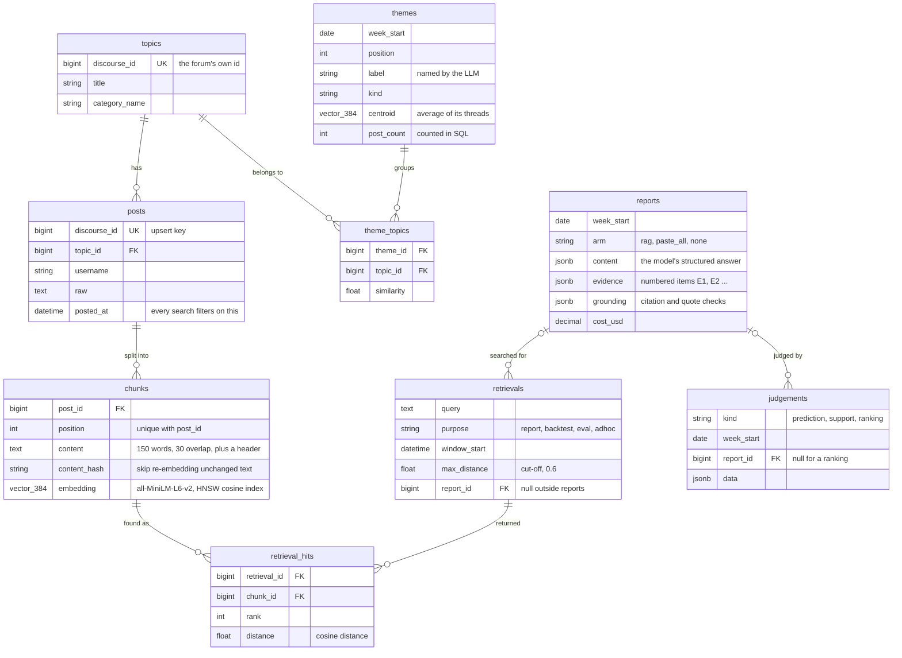
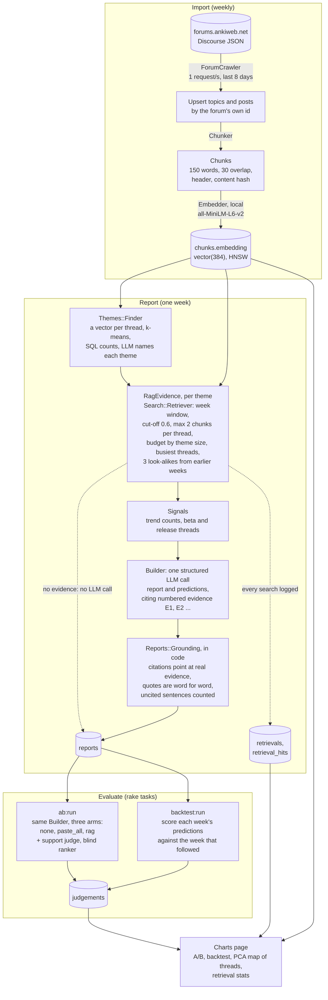

# Community Voices

Every week, this app reads the [Anki forums](https://forums.ankiweb.net), works out what people talked about, and writes a cited "Community Voices" report: what happened last week and what is likely to come up next week. It uses retrieval-augmented generation (RAG) over a pgvector table in Postgres.

**What is Anki?** [Anki](https://apps.ankiweb.net) is the gold-standard app for spaced-repetition flashcards: it shows you each card just before you would forget it. Medical students, serious language learners and many others rely on it. It is open source and has a very active community, which makes its forum a rich, honest source of what users struggle with and ask for. I have used Anki heavily for the last 15 years, so it is a community I know well.

**The headline result** (two weeks, three judged runs, [details](docs/steps/10-ab-test.md)): pasting the whole week into the prompt wrote the best report every time, and RAG came a close second each time, near it on coverage and specificity and a little behind on accuracy. With no posts at all, the LLM can only guess. The first RAG run missed a big thread; finding out why, fixing it, and then checking the fix on a week it was never tuned on is in [step 10](docs/steps/10-ab-test.md). The judge is noisy (the same week re-run moved RAG's scores by 1 to 2 points), so the steady signal is the ranking, not single scores.

**Why RAG anyway: scale.** A week of this forum still fits in a prompt, so pasting it all is a strong baseline today. But pasting grows with the data (12 weeks would be about 750,000 tokens, past any context window), while retrieval grows with the question: the RAG prompt stays at about 17,000 tokens however much history is stored. It is also a third to a half of the cost ($0.12 to $0.19 vs $0.35 to $0.40 per report), but that is a bonus, not the reason.

**How I built it:** I came in knowing RAG without embeddings and learned the rest by explaining every piece back before moving on. [Read how](#how-i-built-it-a-learners-approach).

**Reading guide.** There is a lot of documentation here, because every build step left a page behind. You don't need to read it all:
- **5 minutes:** this intro and [How I built it](#how-i-built-it-a-learners-approach).
- **15 minutes:** add [step 5, retrieval](docs/steps/05-retrieval.md) and [step 10, the A/B test](docs/steps/10-ab-test.md), plus the 7 "Start here" calls at the top of [DECISIONS.md](DECISIONS.md).
- **Everything else** ([step pages](docs/README.md), [concepts](docs/concepts), the rest of DECISIONS.md) is reference.

**See a run without installing anything:** [`docs/samples/`](docs/samples) has one week's report written three ways (RAG, paste the whole week, no context) and how they compared.

## Quick start

You need Docker. To write reports you also need an LLM API key (Anthropic by default); everything else works without one.

```sh
git clone https://github.com/michaelsking1993/community-voices && cd community-voices
cp .env.example .env    # then set LLM_API_KEY in .env, before the next line
docker compose up
```

That starts Postgres (with pgvector), crawls and embeds the last 2 weeks of the forum (about a minute; the first run also downloads a ~90 MB model), and serves the app on http://localhost:3000. For the full demo (A/B test, backtest, trends), open the Data tab and press "Crawl the forum" (it defaults to 12 weeks, about 5 minutes).

- **Changed `.env`?** Run `docker compose up` again (not `restart`, which keeps the old settings).
- **Port 5432 already taken** by a local Postgres? `DB_PORT=5433 docker compose up`.
- **The forum is unreachable?** The app still starts with what is stored; press "Crawl the forum" on the Data tab to try again.

Prefer Ruby on your machine? Run only the database in Docker, then:

```sh
docker compose up -d db
bin/setup
```

### Things to try

With Docker, put `docker compose exec app` in front of each command (for example `docker compose exec app bin/rails report:build`).

| Command | What it does |
|---|---|
| `bin/rails 'ingest:backfill[12]'` | Crawl, chunk and embed 12 full weeks (re-runs only fetch what is new). `IngestWeekJob` also runs every Monday at 6am while the app is up |
| `bin/rails 'retrieval:search[sync problems]'` | Search the way the report does |
| `bin/rails retrieval:eval` | Score retrieval on 15 hand-labelled queries (needs 12 weeks) |
| `bin/rails report:build` | Write last week's report (needs `LLM_API_KEY`), or press "Write report" on the Reports page |
| `bin/rails 'ab:run[1]'` | A/B test last week: three reports, checks, a support judge and a blind ranking (about $0.65). Set `LLM_JUDGE_MODEL` to judge with a different model |
| `bin/rails 'backtest:run[4]'` | Score the last 4 weeks' predictions against what happened next |

The app has seven tabs: Community report (write and read reports), Search (a semantic search box over the stored posts, no LLM key needed), Evaluate (buttons for the A/B test, backtest and retrieval eval), Charts (their results), Data (what is stored, and a button to crawl more, e.g. 12 weeks for the full demo) and Flashcards (study cards for the vocabulary I learned building this: flip, previous/next, shuffle and reset; no database or key needed, the deck is `config/flashcards.yml`) and How I built it (the section of this README with that name). A line under the tabs always says how much forum data the app holds. [Step 12](docs/steps/12-tabbed-ui.md)

The Charts page (http://localhost:3000/charts) draws the A/B test, the backtest, the embedding map and the retrieval stats from whatever is in the database.

Run the tests with `bundle exec rspec` (add `RUN_MODEL_SPECS=1` and `--tag model` to also run the real embedding model).

## How I built it: a learner's approach

This was a fascinating project to me. In a personal project, I’ve been using RAG to compile a learner’s dictionary: 1) lemmatize a word to its base word, 2) find all existing dictionary entries (senses) for that base word in our dictionary, 3) pass the word, the context it was found in, and the existing dictionary entries to the model for it to determine whether one matches - if so, say which one, otherwise, give a 0, which prompts us to generate a fresh entry and associate it with the lemma.

That is RAG, but each lemma only has a handful of senses, so an exact lookup finds them all and every one fits in the prompt. That is basically "paste-all", and it needs no embeddings. Here, a week has hundreds of posts and I had to find the ones that matter by *meaning*, which is where vectors earn their keep. Therefore, building this pipeline was very instructive to me.

Here is how I did it:

I started by uploading the challenge description to Claude, with some blabbering from me about how I wanted to build this; essentially, I told it, “this is what we need to build. However, I want us to build this as if you’re teaching a beginner. Make me explain back every concept to you as we build it, and I won’t let us move on until I’ve thoroughly understood each piece”.

And that is essentially what we did. The project took about a day and a half, most of it spent digesting these concepts and explaining them back in my own words.

The result of the project was initially all in background jobs and rake tasks. I wanted to see things on the interface itself, so we spent some time getting them there: a tabbed UI with semantic search, an Evaluate page with buttons for the A/B test and backtest, and charts of the results.

I’m happy with the result. I wouldn’t call myself an expert in these topics, but I was able to explain them all and therefore I’m pretty confident in being able to apply them.

### What I ended up with, in three steps

1. **Ingest.** A weekly job crawls the Anki forum, cuts every post into 150-word chunks (with a 30-word overlap, so a sentence cut at a chunk boundary still shows up whole in one chunk), and embeds each chunk with a small local model that turns text into 384 numbers. Two chunks that mean similar things end up pointing in a similar direction, and Postgres's `<=>` operator measures that as a "distance".
2. **Report.** Group the week's threads into 4 to 8 themes (k-means), have the LLM name each one, then use each theme's name and summary as a search query to pull the closest chunks from that week. Those chunks become numbered evidence ([E1], [E2] ...), and one LLM call writes the report and the predictions, citing the evidence for every claim. Plain Ruby then checks that every citation is real and every quote is word for word.
3. **Evaluate.** An A/B test writes the same report three ways (paste the whole week, RAG, no context) and grades them with code checks, a support judge and a blind ranker that's a different model. A backtest goes back to old reports and checks whether their predictions came true.

Paste-all came out sliiiiiightly better, every time. At about $0.40 a report against $0.20, the cost gap alone isn't a big deal. The real problem is that pasting stops working once the data no longer fits in a prompt: 12 weeks of posts is about 750,000 tokens. RAG keeps the prompt the same size however much history there is, and that's why it's the right design here. The diagrams and the reasoning behind each piece are [further down](#shape-of-the-system-and-why).

### Plan before code

Before writing any code, I sat down with Claude and wrote a plan: which community, which stack, the shape of the pipeline, how to make the A/B test fair, and what to cut. I didn't build anything until I'd made every open decision in it. The [deferred list](#built-vs-deferred) was decided then, not when I ran out of time.

### The same loop for every step

The build was 12 steps, and every one of them went through the same five beats:

| Beat | What happened |
|---|---|
| **Learn** | Get the idea explained before any code, then predict the result or explain it back |
| **Decide** | Lay out the options and the trade-off, and write it down as a [DECISIONS.md](DECISIONS.md) row |
| **Build** | One small pull request, with tests and green CI |
| **Check** | Run it on real forum data and measure it, not just "it runs" |
| **Document** | One page in [`docs/steps/`](docs/steps): what we built, why, how it works, what I learned, what's next |

That Document beat is why there's so much documentation: it's a by-product of how I learned, one page per step written as I went. The [reading guide](#community-voices) at the top says where to start.

### Guess first, then measure

Before any app code, I did a little [concepts lab](docs/steps/02-concepts-lab.md). I guessed which of six forum-style sentences were most alike, then we embedded them with the same model the app uses. I got the ranking right ("make the card text bigger" and "change the font size" closest, "font size" and "network error" furthest). But I guessed 0.8 for the pair about losing data on sync, and it came out 0.37.

That miss turned into a rule for the whole project: no picking thresholds by feel. The retrieval cut-off (0.6), the number of themes and the trend distance (0.35) were each picked from a sweep on real data, and the sweeps are on the step pages.

### Questions to check myself

The later step pages end with "Check yourself" questions, like "Paste-all scored a bit higher than RAG. Why is RAG still the right design for this app?" They're there so I can explain each step, not just run it. The [concepts](docs/concepts) pages are the short explanations I wish I'd had when I started.

### Small, tested pull requests, and decisions in writing

The work landed as about 20 small pull requests, each one reviewed and merged before the next one built on it. CI runs a security scan, lint, the RSpec suite against a real pgvector Postgres, and a `docker compose` build, so the reviewer's path is tested too. The embedding model and the LLM are injected, so specs use fakes and never touch the network. [DECISIONS.md](DECISIONS.md) records every call with its trade-off, and when something I found later overturned a call, the new row says what it replaces (#49 supersedes part of #41).

### Reviews and real data caught real problems

Every pull request was reviewed by a fresh Claude session that hadn't written it, and then by me: tests first, code second. Here's some of what that, plus running on real data, caught:

- **The A/B test was unfair to the rival.** The paste-all arm was pasting overlapping chunks, which inflated its cost by about 40%, and it was being handed our themes, which leaked the RAG pipeline into it. I rebuilt it as "each post once, no themes" and re-ran it (#49). RAG's cost advantage shrank from 3.1 times to 2.7 times, and the write-up says so.
- **The judge was grading its own homework.** The judges defaulted to the same model that wrote the reports. `LLM_JUDGE_MODEL` now lets a different model judge, and the published run uses one (#44, #50).
- **RAG missed the week's second-biggest thread.** The blind judge caught it. The thread was in the right theme, but every theme got 6 chunks no matter how big it was, and a query built from a theme's centre can't see a big thread sitting at its edge. Splitting the budget by theme size and always including each theme's busiest threads took the coverage score from 3 to 5 (#53). But I'd tuned that on the same week, so I re-ran it on a week it had never seen: coverage 4, still second to paste-all. Better, not solved. [Step 10](docs/steps/10-ab-test.md) keeps all the runs side by side.
- **My own answer key was wrong.** One retrieval eval query "failed" because the retriever found a relevant thread I hadn't labelled. Hand labels are a starting point, not the truth.
- **Real data broke my assumptions.** Forum post ids are only roughly in date order, so the first crawler stopped too early. And a half-crawled oldest week made activity look like it was rising. Both have specs now.

### What I owned

I owned the decisions: the plan, every row in DECISIONS.md, and every merge, after reading the specs and the diff. [`docs/notes.md`](docs/notes.md) are my running notes; Claude drafted an entry after each step and I edited it.

## Where each part of the challenge lives

| The challenge asks for | Where it is |
|---|---|
| An active online community | The [Anki forums](https://forums.ankiweb.net) (Discourse): ~310 posts in ~100 threads a week. Why: [DECISIONS #1](DECISIONS.md) |
| A Community Voices Document: last week and next week | The Reports page, or `bin/rails report:build`: themes, cited claims, word-for-word quotes, and checkable predictions. [Step 7](docs/steps/07-report.md), [step 8](docs/steps/08-predictions.md) |
| RAG, on a vector store | pgvector in Postgres, local embeddings, retrieval per theme with a date window, a distance cut-off and max 2 chunks per thread. [Step 4](docs/steps/04-chunk-and-embed.md), [step 5](docs/steps/05-retrieval.md) |
| A flattened view of the embeddings | Charts page: a PCA map of every thread. [Step 11](docs/steps/11-charts.md) |
| Stats on which embeddings are retrieved most | Charts page: every search is logged (`retrievals`, `retrieval_hits`). [Step 5](docs/steps/05-retrieval.md) |
| Automated ingest, and handling too much data | A polite crawler, a weekly job (Mondays 6am), incremental chunk-and-embed. [Step 3](docs/steps/03-ingest.md) |
| An A/B test: with and without RAG | Three arms (no context, paste the whole week, RAG), checked in code and by a blind judge: `bin/rails 'ab:run[1]'`, then the Charts page. [Step 10](docs/steps/10-ab-test.md) |
| (extra) Did the predictions come true? | A backtest against the week that followed: `bin/rails 'backtest:run[4]'`. [Step 9](docs/steps/09-backtest.md) |

## The problem, restated

The rest of this README is laid out like a system-design answer: the problem, the questions and assumptions, the entities, the shape of the system and why, what was built and what was deferred, and what could go wrong.

**Input.** One active online community: the Anki forums, a public Discourse site. A normal week is about 310 posts in about 100 threads by about 110 people, roughly 50,000 tokens of text.

**Output.** Every week, a Community Voices document: what the community talked about last week, and what it will probably talk about next week.

**What the challenge requires**

- Fill a vector store automatically with the community's posts, every week, without drowning in data.
- Use RAG to write the document.
- Show a flattened view of the embeddings, and keep stats on which embeddings are retrieved most.
- A/B test: the same document written with and without RAG, compared inside the app.

**What I added as requirements of my own**

- **Every claim can be traced to a post.** A report that sounds right but cannot be checked is worse than no report.
- **Numbers are exact.** Post and thread counts come from SQL, never from the model.
- **A reviewer can run it from `git clone`.** Docker, one optional API key, and everything except writing reports works without one.
- **Re-running is cheap.** Only new or changed text is ever fetched or embedded.

**What makes it interesting.** A week of posts *fits* in a modern context window. So RAG has to beat "paste the whole week into the prompt", not just "ask the model with nothing". And "next week" cannot be checked until it has happened, so predictions need a backtest to mean anything.

## Questions I asked, and the assumptions I made

Every call is in [`DECISIONS.md`](DECISIONS.md) (60 rows: the question, the options, the trade-off, the choice). The assumptions that shape everything else:

- **"A week" is Monday to Monday** (#27), so "last week" and "next week" are unambiguous, and partly crawled weeks are left out of counts and trends (#51).
- **The community is its public posts.** Private messages and staff-only posts are not in the public API, so our post counts are lower than the forum's own (topic counts match within 2; [step 3](docs/steps/03-ingest.md)).
- **The scale is thousands of chunks, not millions** (12 weeks is about 3,400 chunks), so the vectors live in Postgres, next to the posts they came from (#2).
- **The model writes words; SQL counts** (#25). The model labels themes and writes the report; it never produces a number.
- **Reports are outputs, never sources** (#31). The model never retrieves its own earlier claims.

## Entities

**The names come from the forum.** forums.ankiweb.net runs on [Discourse](https://www.discourse.org/), and `topics` and `posts` keep Discourse's own names so each table maps one to one onto its API:

- A **topic** is a thread: a title, a category and a list of posts. ("Topic" here does not mean "subject"; that is what a theme is.)
- A **post** is any message in a thread. Discourse has no separate "comment": the opening message is post 1 and every reply is another post (2, 3, ...).
- A **theme** is ours, not Discourse's: a group of one week's threads about the same thing, computed by clustering.

| Table | What it holds |
|---|---|
| `topics` | One row per forum thread: title, slug, category ("Anki › FSRS") |
| `posts` | One row per forum post: author, raw text, date. Keyed on the forum's own id |
| `chunks` | Up to 150 words of one post, with a topic/category/date header, a content hash, a 384-number embedding (HNSW index), and the name of the model that made it |
| `themes`, `theme_topics` | A week's themes: a label, summary and kind written by the LLM, counts from SQL, and the threads in each |
| `reports` | A generated report: the model's structured answer, the numbered evidence it cited, the citation and quote checks, tokens and cost. Outputs only, never searched |
| `judgements` | What a judge concluded about a report: prediction scores (backtest), support checks and blind rankings (A/B) |
| `retrievals`, `retrieval_hits` | Every search the app runs: the query, window and settings, and each chunk it returned with its rank and distance |

How the tables connect (key columns only; [`db/schema.rb`](db/schema.rb) has the rest):



Two links are by week, not by foreign key: a report and its themes share a `week_start`, and a ranking judgement covers all three A/B reports of its week.

## Shape of the system, and why

Importing and reporting are separate jobs. The import (`IngestWeekJob`, Mondays at 6am on Solid Queue) only adds data; a report (`GenerateReportJob` from the "Write report" button, or `bin/rails report:build`) reads whatever is stored, so it can be written for any past week without touching the forum.



<details>
<summary>The same pipeline as plain text, with its settings</summary>

```
 INGEST (weekly job, Mondays 6am, Solid Queue)
   forums.ankiweb.net ─► Crawler ─► topics, posts ─► Chunker ─► local embedder ─► chunks
                         1 req/s,                    150 words,  MiniLM, 384 dims   vector(384),
                         upsert by id                header, hash                   HNSW index

 WRITE A REPORT (for one week)
   Themes      k-means over thread vectors; SQL counts threads, posts, people; the LLM names each
   Retrieve    per theme: Retriever(label + summary), week window, cut-off 0.6, max 2 per thread,
               a chunk budget shared by theme size, plus each theme's 2 busiest threads
               + 3 look-alikes from earlier weeks, trend counts, beta and release threads
   Generate    one structured LLM call: report + predictions, citing numbered evidence [E1]..
   Check       code: citations point at real posts, quotes are word for word, uncited sentences

 EVALUATE
   A/B         the same builder with three evidence sources: none, paste the whole week, RAG
               + a support judge and a blind ranker
   Backtest    score past predictions against the week that followed
   Charts      A/B, backtest, PCA map of every thread, retrieval stats from the retrieval log
```

</details>

Why this shape:

- **One Postgres does everything.** Posts, vectors, jobs and the retrieval log share one database, so a date filter and a vector search are one SQL query, and a reviewer runs one service. A dedicated vector database earns its keep at hundreds of millions of vectors, not 3,400. (#2, #6; [when a vector DB helps](docs/concepts/vector-databases.md))
- **Find the themes first, then retrieve per theme.** "What did people talk about?" is not one search query. Clustering the week's threads gives the questions, and one retrieval per theme gives each section its own evidence, so a quiet theme is not drowned by a loud one. (#23, #28)
- **Retrieval is more than "nearest".** Nearest *and* close enough (a cut-off, so "not enough evidence" is possible) *and* not all one thread *and* in the right week. Each knob was set by measuring on a hand-labelled eval set. And because "what sounds like this theme?" is not "what was big this week?", SQL also picks each theme's busiest threads and vectors pick their best chunk. (#18, #19, #20, #53; [step 5](docs/steps/05-retrieval.md))
- **Grounding is designed in, then checked in code.** Numbered evidence, cite-or-omit, word-for-word quotes, SQL numbers, and no model call at all when nothing relevant is found. (#29, #30; [grounded prompting](docs/concepts/grounded-prompting.md))
- **The LLM sits behind an injected interface.** Specs use a fake; the provider is a setting (`LLM_PROVIDER`), and every call records tokens and cost, which the A/B needs. (#26)
- **Embeddings are local.** No second key, no cost per embedding, and the model is the same in tests, the concepts lab and production. (#16)
- **Too much data is handled at both ends.** Ingest is incremental (upserts, a content hash, only the last 8 days re-fetched), and retrieval keeps the prompt at about 17,000 tokens however much history is stored. Pasting grows with the data; retrieval grows with the question. (#8, #15)
- **Evaluation lives in the app.** The A/B test, the judges and the backtest are rake tasks that write to tables the Charts page reads, so anyone can re-run them. (#43, #39)

## Built vs deferred

Everything the challenge asks for is built (see [where each part of the challenge lives](#where-each-part-of-the-challenge-lives)). These were cut on purpose while planning, before any code, so the time went into evaluation instead.

| Deferred | What it is | Why not now | When it would be worth it |
|---|---|---|---|
| **Tree RAG** | Summarise clusters, then summaries of summaries, and retrieve at the level a question needs (vanilla RAG retrieves raw chunks only) | A week is about 50,000 tokens, and the themes already act as a one-level tree: cluster the threads, then retrieve within each cluster | When a report covers months: 12 weeks would be about 750,000 tokens |
| **Hybrid search** | Postgres full-text search alongside the vectors, merged by rank | Report queries are about themes, not exact strings. Vector-only found a right thread for every one of the 15 eval queries (#21) | For version numbers ("26.09.2") and error messages; the eval set is the tripwire |
| **A second forum** | Ingest another community, e.g. a subreddit or another Discourse site | One source proves the pipeline. A second adds a client and a source column, not a new idea, and Reddit's API is gated (#1) | When the product is "any community"; the crawler is already behind one client class |
| **PDF export** | A printable file | The challenge accepts a web page. Reports render in the app and download as Markdown | When readers want a file to send around |
| **Automatic theme counting** | Let the data choose the number of themes (HDBSCAN, or agglomerative clustering with a distance threshold) | I measured k = 4 to 12 on three weeks: silhouette stays at 0.05 to 0.12, so there is no natural number to find. HDBSCAN has no Ruby library. k = threads / 12, kept between 4 and 8, avoids one-thread themes (#24) | If mixed themes (one-off threads forced into a group) start hurting reports |

Smaller items are listed under "What I would do next" on each [step page](docs/README.md): MMR instead of the per-thread cap, a token-exact chunk splitter, tracking post edits, pgvector 0.8 iterative scans, and more A/B weeks.

## What could go wrong

| Risk | Seen? | What is in place | What is left |
|---|---|---|---|
| **Retrieval misses a big thread.** No theme's query lands near it, so the model never sees it | Yes: the first A/B run missed the week's second-biggest thread, which paste-all covered ([step 10](docs/steps/10-ab-test.md)) | A chunk budget shared by theme size, and each theme's 2 busiest threads always included (#53). On the rerun the judge's coverage score went from 3 to 5; on a fresh week it was 4 | On the fresh week RAG still underweighted some big threads (Browse, search and image regressions). A big thread whose theme the search finds nothing for can still be missed. (Themes 7 and 8 went unreported until #55) |
| **The model invents details** | The blind judge counts several "invented" specifics in both grounded reports; for RAG some are trend counts and earlier-week references its facts cannot confirm either way | Cite-or-omit, code checks on every citation and quote, SQL-only numbers, no call without evidence, a support judge | Specifics in prose can still slip through; the support judge is a model too |
| **The judge is biased or noisy** | Yes: the same week re-run from scratch moved RAG from 5 / 4 / 5 / 4 to 4 / 2 / 4 / 3 ([step 10](docs/steps/10-ab-test.md)); the ranking stayed the same | A different judge model (`LLM_JUDGE_MODEL`), reports shuffled and stripped of citation ids | More weeks, each ranked in two orders |
| **Themes are mixed** | Yes: k-means puts every thread in some group, so one-off threads join the nearest theme | Only themes with 2 or more threads are written up; the LLM sees titles and excerpts when naming | Threshold or density clustering (deferred above) |
| **Confidence means little** | High-confidence predictions scored 0.25 against 0.50 for low, on only 2 scored high ones | The backtest measures it ([step 9](docs/steps/09-backtest.md)) | Score more weeks; tell the model how often each level has been right |
| **A report peeks at the future** | Not seen | Every query is bounded by the report's week; a spec plants a future post and checks it never reaches the prompt | Posts edited or threads renamed after the fact can still leak a little |
| **The forum is slow, down or changes** | Not in a live run; guarded anyway | Retries on 429, 5xx and timeouts; the app starts with stored data if the crawl fails (#52) | A change to the API's shape would only show on a live run, since specs use fixtures |
| **A filtered vector search comes back short** | Yes: a flaky spec and a short 1-week window ([step 5](docs/steps/05-retrieval.md)) | `hnsw.ef_search` raised to 200 for every search | pgvector 0.8 iterative scans |
| **The embedding model is switched** | Not seen; found while reviewing | Every chunk is stamped with its model; the Embedder re-embeds other models' chunks, the Retriever compares only same-model vectors, and a length check runs before any work (#54) | Themes and the map can mix models until the next embed run |
| **Growth** | 12 weeks is about 3,400 chunks and about 15 minutes to embed on CPU the first time | Incremental embedding (content hash), retrieval keeps the prompt small | A hosted or GPU embedder for a much larger forum |
